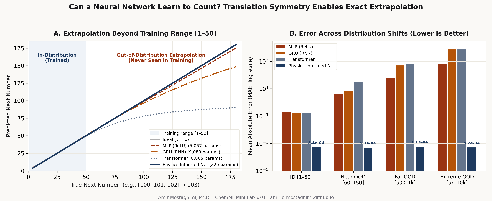

# ChemML Mini-Lab

**Short, runnable PyTorch & RDKit mini-experiments on physics-informed machine learning, out-of-distribution extrapolation, and AI for chemistry & materials discovery.**

*Created by [**Amir Mostaghimi, Ph.D.**](https://amir-b-mostaghimi.github.io) · Postdoctoral Researcher, University of Calgary · [Google Scholar](https://scholar.google.com/citations?user=tVTXaxEAAAAJ) · [ORCID](https://orcid.org/0000-0002-8084-9498) · [LinkedIn](https://www.linkedin.com/in/amir-mostaghimi/)*

---

## Issues

### [Issue #01 — Can a Neural Network Learn to Count?](./01_can_nn_learn_to_count/)
[](https://colab.research.google.com/github/amir-b-mostaghimi/chem-ml-minilab/blob/main/01_can_nn_learn_to_count/01_can_nn_learn_to_count.ipynb)

- **Question:** Trained strictly on variable-length integer sequences in `[1–50]` (e.g., `[10, 11, 12, 13, 14] → 15`), can an MLP, GRU, or Transformer extrapolate to `10,000`? Why do more advanced models fail *worse* out of distribution, and can data augmentation fix them?
- **Key Findings:**
  - Inside `[1–50]`, MLP, GRU, and Transformer all achieve `0.17–0.22` MAE.
  - On Extreme OOD `[5,000–10,000]`: **Transformer (`7,572` MAE)** freezes at `~96` due to LayerNorm magnitude erasure (cosine similarity `0.994` at `k=500`), **GRU (`7,446` MAE)** freezes at `~222` due to bounded `tanh`/`sigmoid` gate saturation (`75%` units saturated), and **MLP (`618` MAE)** drifts linearly.
  - A **225-parameter Physics-Informed Net** encoding translation equivariance (`f(x + c) = f(x) + c`) achieves **`0.0005` MAE** across all regimes (`[1–10,000]`) and `<0.005` OOD MAE with just 25 training sequences.
  - Keeping MLP, GRU, and Transformer **100% untouched**: 4× wider data augmentation (`[1–200]`) fails to remove the saturation wall, while **symmetry-aware local-frame representation (`x − x_last`)** drops all three to **`0.0000–0.0034` MAE**.



---

## Quick Start

```bash
git clone https://github.com/amir-b-mostaghimi/chem-ml-minilab.git
cd chem-ml-minilab/01_can_nn_learn_to_count
python3 run_experiment.py
python3 run_deep_dive.py
```

## Citation
If you reuse any notebook or figure in teaching or research, please cite via the included [`CITATION.cff`](./CITATION.cff).
